<!-- 1. Introduction -->

---

## What I Do

<a href="https://github.com/mubasherdevv/seo-auto-filler"><picture><source media="(prefers-color-scheme: dark)" srcset="./cards/service-seo-dark.svg"></picture></a><a href="https://github.com/mubasherdevv/website_builder"><picture><source media="(prefers-color-scheme: dark)" srcset="./cards/service-web-dark.svg"></picture></a><a href="https://github.com/mubasherdevv/emailautomation"><picture><source media="(prefers-color-scheme: dark)" srcset="./cards/service-ai-dark.svg"></picture></a>

---

## Tech Stack

<picture>
  <source media="(prefers-color-scheme: dark)" srcset="./cards/techstack-dark.svg">
  
</picture>

---

## Education

<picture>
  <source media="(prefers-color-scheme: dark)" srcset="./cards/education-dark.svg">
  
</picture>

---

## GitHub Stats &amp; Streak

  <a href="https://github.com/mubasherdevv?tab=overview">
    <picture>
      <source media="(prefers-color-scheme: dark)" srcset="./cards/stats-dark.svg">
      
    </picture>
  </a>

  <a href="https://github.com/mubasherdevv?tab=overview">
    <picture>
      <source media="(prefers-color-scheme: dark)" srcset="./cards/graph-dark.svg">
      
    </picture>
  </a>

---

## Contact

  
  
  

Profile cards are self-contained SVGs rendered by <a href="./scripts/render_cards.py">render_cards.py</a> and refreshed daily from live GitHub data.
