<a href="https://github.com/mubasherdevv/website_builder"><picture><source media="(prefers-color-scheme: dark)" srcset="./cards/securesite-dark.svg"></picture></a><a href="https://github.com/mubasherdevv/emailautomation"><picture><source media="(prefers-color-scheme: dark)" srcset="./cards/n8n-dark.svg"></picture></a>
<a href="https://github.com/mubasherdevv?tab=repositories"><picture><source media="(prefers-color-scheme: dark)" srcset="./cards/whatsapp-dark.svg"></picture></a><a href="https://github.com/mubasherdevv/auto-dm-insta"><picture><source media="(prefers-color-scheme: dark)" srcset="./cards/leads-dark.svg"></picture></a>
<a href="https://github.com/mubasherdevv/snap-bite"><picture><source media="(prefers-color-scheme: dark)" srcset="./cards/snapbite-dark.svg"></picture></a><a href="https://github.com/mubasherdevv/seo-auto-filler"><picture><source media="(prefers-color-scheme: dark)" srcset="./cards/seo-dark.svg"></picture></a>

<a href="https://github.com/mubasherdevv?tab=overview"><picture><source media="(prefers-color-scheme: dark)" srcset="./cards/graph-dark.svg"></picture></a>

### Technical Stack & Background

| Area | Stack & Focus |
| :--- | :--- |
| **Frontend** | React, Next.js, JavaScript, TypeScript, HTML, CSS, Tailwind CSS |
| **Backend & Data** | Node.js, Supabase, REST APIs, JSON |
| **AI & Agentic Systems** | OpenAI API, Gemini API, LLM integrations, agent/workflow concepts |
| **Automation** | n8n, webhooks, workflow automation, Google Sheets integrations |
| **Tools & CMS** | Git/GitHub, WordPress, Elementor |

- **Experience:** **Red Vision LLC — Off-Page SEO** (link building, guest posting, blogger outreach, business listings/citations, WordPress, HTML/CSS/JS maintenance)
- **Education:** **Diploma of Associate Engineering (DAE)**, Malaysian Institute of Technology (2022–2025)
- **Location:** Lahore, Pakistan · [Email](mailto:withm345@gmail.com) · [LinkedIn](https://www.linkedin.com/in/mubasher-developer-98a5ab37a/) · [All Repositories](https://github.com/mubasherdevv?tab=repositories)

These cards are SVG, drawn by <a href="./scripts/render_cards.py">one Python script</a> and redrawn every morning from live GitHub data.
